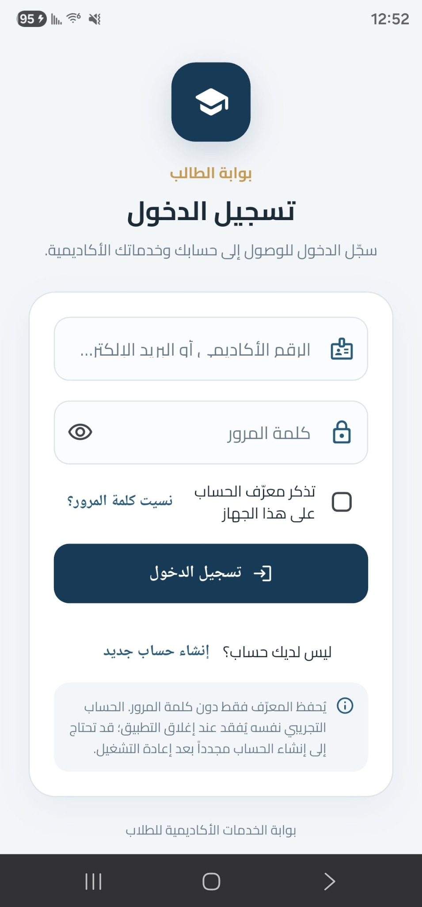
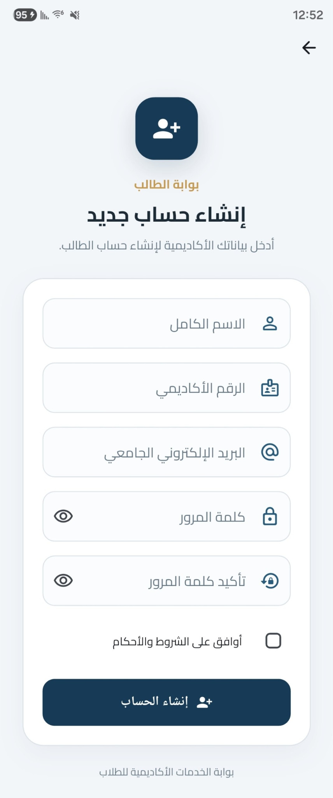
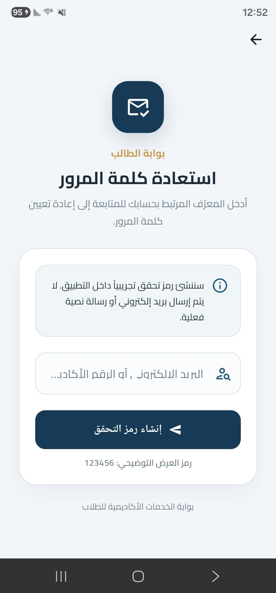
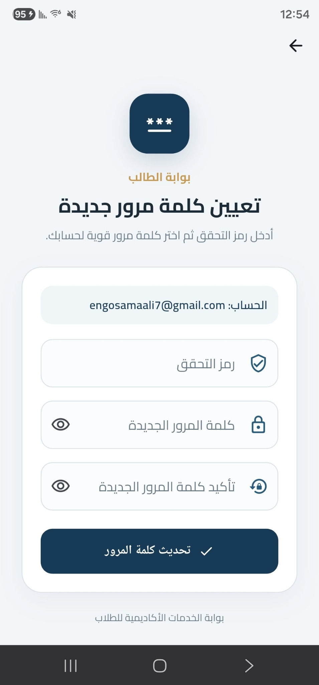

# EDU GATE — نظام المصادقة الطلابي

**EDU GATE** هو تطبيق تعليمي مبني باستخدام Flutter وDart، يهدف إلى تقديم نظام مصادقة طلابي باللغة العربية، مع دعم اتجاه الكتابة من اليمين إلى اليسار (RTL).

يوفر التطبيق دورة مصادقة متكاملة تتضمن تسجيل الدخول، إنشاء حساب جديد، استعادة كلمة المرور، وتعيين كلمة مرور جديدة.

---

## صور واجهات التطبيق (Application Screenshots)

<p align="center">
  <strong>1. تسجيل الدخول — Login</strong><br>
  
</p>

<p align="center">
  <strong>2. إنشاء حساب جديد — Register</strong><br>
  
</p>

<p align="center">
  <strong>3. استعادة كلمة المرور — Forgot Password</strong><br>
  
</p>

<p align="center">
  <strong>4. تعيين كلمة مرور جديدة — Reset Password</strong><br>
  
</p>


## 1. معلومات المشروع

| العنصر | التفاصيل |
|---|---|
| اسم المشروع | EDU GATE |
| اسم مجلد المشروع | `edu_gate_guth` |
| لغة البرمجة | Dart |
| إطار العمل | Flutter |
| معمارية المشروع | MVC + Repository Pattern |
| لغة الواجهة | العربية |
| اتجاه الواجهة | RTL |
| Android Namespace | `com.example.edu_gate_guth` |
| Application ID | `com.example.edu_gate_guth` |

## 2. الوظائف الرئيسية

- تسجيل الدخول باستخدام الرقم الأكاديمي أو البريد الإلكتروني.
- إنشاء حساب طالب جديد والتحقق من صحة البيانات.
- منع تكرار الرقم الأكاديمي والبريد الإلكتروني.
- إظهار وإخفاء كلمة المرور.
- تذكر معرّف الحساب على الجهاز دون حفظ كلمة المرور.
- استعادة كلمة المرور باستخدام رمز تحقق تجريبي OTP.
- تعيين كلمة مرور جديدة والتحقق من تطابقها.
- عرض رسائل النجاح والفشل باللغة العربية.
- مؤشرات تحميل ومنع إرسال العمليات المتزامنة.

## 3. واجهات التطبيق

يتكون التطبيق من أربع واجهات رئيسية:

1. تسجيل الدخول (Login).
2. إنشاء حساب جديد (Register).
3. استعادة كلمة المرور (Forgot Password).
4. تعيين كلمة مرور جديدة (Reset Password).

**مشاهدة صور الواجهات:**

[عرض صور الشاشات الأربع والتوثيق المرئي](docs/SCREENS.md)

## 4. المعمارية البرمجية

يعتمد المشروع على MVC مع Repository Pattern، بهدف فصل مسؤوليات التطبيق وتنظيم تدفق البيانات.

| الطبقة | المسؤولية |
|---|---|
| Models | تمثيل بيانات المستخدم وطلبات المصادقة |
| Repositories | إدارة عمليات المصادقة والبيانات |
| Controllers | إدارة حالة التطبيق وعمليات المصادقة |
| Services | التعامل مع تخزين معرّف الحساب |
| Views | بناء شاشات التطبيق ومكونات الواجهة |
| Utils | أدوات التحقق والثوابت المشتركة |

يستخدم `AuthController` لإدارة الحالة باستخدام `ChangeNotifier`، بينما يتولى `AuthRepositoryImpl` تنفيذ عمليات المصادقة التجريبية.

## 5. التقنيات المستخدمة

- Flutter SDK.
- Dart.
- Material Design.
- ChangeNotifier.
- Repository Pattern.
- Android SharedPreferences عبر MethodChannel.
- Local Font Assets.
- Flutter Testing.

لا يعتمد التطبيق على حزم خارجية من pub.dev وفق إعدادات المشروع.

## 6. متطلبات التشغيل

لتشغيل المشروع تحتاج إلى:

- Windows.
- Flutter SDK.
- Dart SDK المتوافق مع `pubspec.yaml`.
- JDK 17 أو أحدث.
- Android SDK.
- جهاز Android أو محاكي.
- ملف Cairo Variable TTF الرسمي وفق متطلبات التحقق الموضحة في توثيق الخطوط.

## 7. تشغيل المشروع

من مجلد المشروع الرئيسي نفّذ:

```powershell
flutter pub get
```

ثم تحليل المشروع:

```powershell
flutter analyze
```

تشغيل الاختبارات:

```powershell
flutter test
```

تشغيل التطبيق على الهاتف:

```powershell
flutter devices
```

```powershell
flutter run -d DEVICE_ID
```

استبدل `DEVICE_ID` بمعرّف الهاتف الظاهر في قائمة الأجهزة.

## 8. الاختبارات والتحقق

يتضمن المشروع 33 اختبارًا مكتوبًا للتحقق من وظائف المصادقة والتحقق من البيانات.

تُعرض حالة تنفيذ الاختبارات والبناء والقيود البيئية في:

[TEST_REPORT.md](TEST_REPORT.md)

لا تُعد الاختبارات ناجحة إلا بعد تنفيذها فعليًا والتحقق من نتائجها.

## 9. حدود النسخة التعليمية

هذا المشروع نموذج تعليمي تجريبي وليس نظام مصادقة إنتاجيًا.

- لا يوجد خادم خلفي (Backend).
- بيانات الحسابات محفوظة في الذاكرة أثناء تشغيل التطبيق.
- رمز OTP ثابت للاختبار: `123456`.
- لا يتم إرسال رسائل بريد إلكتروني أو رسائل SMS فعلية.
- كلمات المرور محفوظة في الذاكرة كنص صريح لأغراض التكليف.
- لا توجد قاعدة بيانات دائمة للحسابات.
- خيار Remember Me يحفظ معرّف الحساب فقط، ولا يحفظ كلمة المرور أو ينشئ جلسة دخول مستمرة.

## 10. ملفات التوثيق

| الملف | الوصف |
|---|---|
| [README_AR.md](README_AR.md) | التوثيق الفني العربي الكامل |
| [SCREENS.md](docs/SCREENS.md) | صور واجهات التطبيق |
| [TEST_REPORT.md](TEST_REPORT.md) | تقرير الاختبارات والتحقق |
| [BUILD_AND_PACKAGE.ps1](BUILD_AND_PACKAGE.ps1) | سكربت البناء والتحقق والتجهيز للتسليم |
| [pubspec.yaml](pubspec.yaml) | إعدادات المشروع والاعتماديات |

## 11. تجهيز نسخة التسليم

يتضمن المشروع سكربتًا مخصصًا للتحقق من المتطلبات، وتشغيل التحليل والاختبارات، وبناء APK، وفحص الملفات وإنشاء أرشيف التسليم.

اسم أرشيف التسليم المعتمد:

`edu_gate_guht_FINAL_SUBMISSION.zip`

راجع متطلبات الخط ونتائج الفحص قبل اعتماد النسخة النهائية.

---

**EDU GATE — Student Authentication System**

Academic Flutter Project
